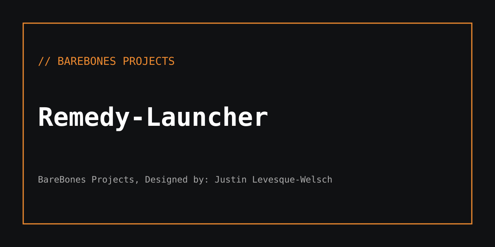

# Remedy Launcher
**BareBones Projects · Alpha development · not a verified native installer**

Remedy Launcher provides a read-only release discovery CLI, a browser-preview catalog of BareBones repositories, and an experimental, explicit-consent **user-scoped managed artifact** workflow. It does **not** yet deploy native OS packages or run a signed desktop companion. Do not describe browser catalog cards as verified downloads.

## Quickstart
Requires Node.js 20 or 22 (other versions unverified).
```sh
git clone https://github.com/BareBones-Projects/Remedy-Launcher.git
cd Remedy-Launcher
npm run check
npm test
npm run start -- status
npm run start -- releases-url
npm run start -- browser-bridge
```
The browser UI in `public/` needs an HTTP host and is not an installed desktop application. Detailed development steps: [Development](docs/DEVELOPMENT.md).

## Documentation
- [Architecture and directory map](docs/ARCHITECTURE.md)
- [Installation, permissions and usage](INSTALLATION.md)
- [Development and reproducible commands](docs/DEVELOPMENT.md)
- [Functional and negative-path testing](docs/TESTING.md)
- [Packaging, channels, release gates and rollback](docs/RELEASE.md)
- [Identity migration and design decisions](docs/DECISIONS.md)
- [Security policy, versions and branch policy](SECURITY.md)
- [Changelog](CHANGELOG.md)
- [Alpha readiness and known limitations](docs/ALPHA_READINESS_AUDIT.md)
- [Existing managed install foundation](docs/MANAGED_INSTALL.md)

## Ecosystem directory
The launcher preview groups repository image cards into **Browse & Extensions**, **BareBones Tools & Services**, **BareBones Themes** and **Plugins**. Cards open the respective GitHub repositories. The directory includes [Tuna Browser](https://github.com/BareBones-Projects/Tuna-Browser), [Dark Search Extension](https://github.com/BareBones-Projects/dark-search-extention), [TruthMeta](https://github.com/BareBones-Projects/TruthMeta), and other BareBones projects. [BareTools](https://github.com/BareBones-Projects/BareTools) is the free-tools destination. Entries are links, not trust endorsements or installation commands.

## Security and privacy
Only an approved, pre-pinned Ed25519 public key can authenticate production manifests. Local CLI key mappings are a test seam, **not** an automatically trusted source. SHA-256 detects changes to bytes; it is not malware scanning. Browser folder preview uses files explicitly selected by a user; do not submit sensitive files or secrets to support forms. Network requests made by the preview/API depend on how it is hosted. [Security details](SECURITY.md).

## Tests and release status
Run `npm run check && npm test`. Consult [GitHub Actions](https://github.com/BareBones-Projects/Remedy-Launcher/actions) for the exact commit's passing results. The source package workflow is **not** evidence of notarized/signed Windows, macOS or Linux installers. [Release gates](docs/RELEASE.md).

## Troubleshooting
Unsupported host: use Node.js on x64/arm64 Windows/macOS/Linux. Signature failure: confirm the manifest, expected key, product and platform. No stable release: check published assets in the allowed repository. Do not disable verification to bypass a failure. [More details](docs/TESTING.md).

BareBones Projects, Designed by: Justin Levesque-Welsch.

[Legal](https://github.com/BareBones-Projects/legal-page)
